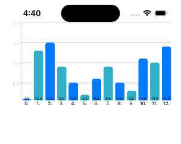

# BarChart (2021)

Simple Swift UIKIt BarChart, Reuploaded from 2021 (Rip stars)



## Example Usage

```Swift
import UIKit

class ViewController: UIViewController {
    @IBOutlet weak var barChart: BarChartView!
    let values = [1.0, 13.0, 15.0, 9.0, 5.0, 2.0, 6.0, 9.0, 5.0, 3.0, 11.0, 10.0, 14]

    override func viewDidLoad() {
        super.viewDidLoad()
        barChart.maxValue = 20.0
        barChart.drawChart(values)
    }
}
```
